# Assignment 3 — Production Maintenance Drill (OPS Checklist)

Part of the DevOps Micro Internship (DMI) Cohort 3 with Agentic AI

---

## Purpose

In this assignment, you will treat your already deployed React application (on Ubuntu VM with Nginx) as a live production system. You will perform structured operational checks covering network validation, service health, log analysis, resource monitoring, configuration verification, and incident simulation with recovery — mirroring real on-call DevOps responsibilities.

---

# Task 1 — Server Access & Networking Validation

## Goal

Verify that the deployed React application is reachable from the browser and confirm basic network connectivity of the Ubuntu VM.

### Evidence

#### Screenshot 1 — Browser showing the React app with your Full Name visible on the UI

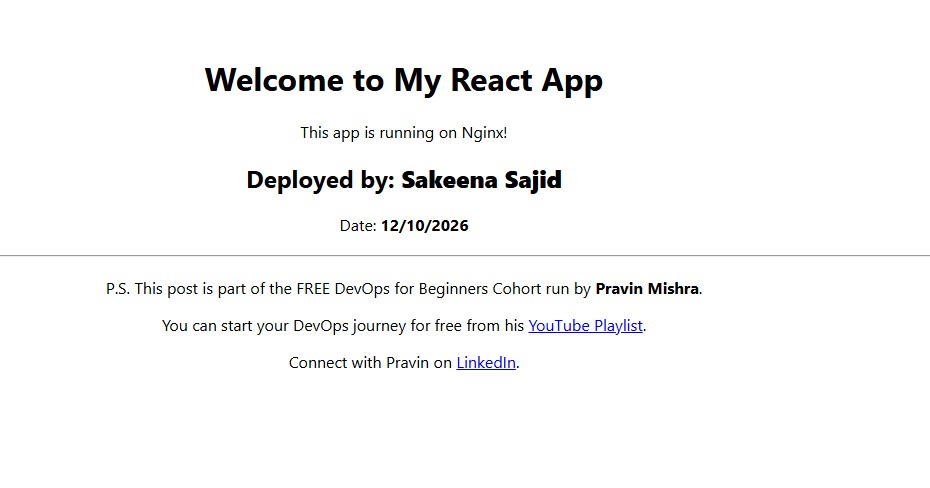

#### Screenshot 2 — Output of `ip a`

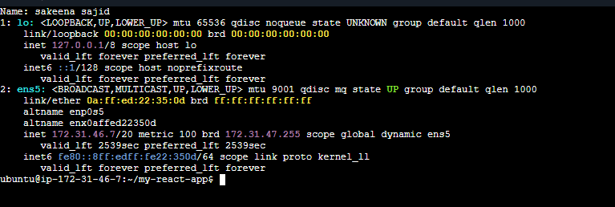

#### Screenshot 3 — Output of `sudo ss -tulpen`

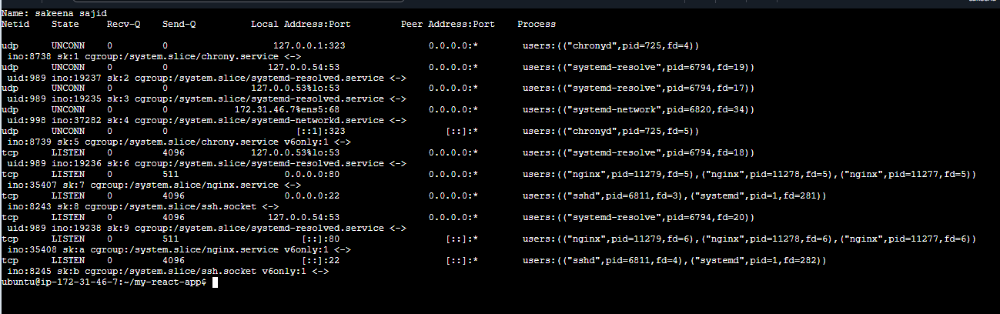
#### Screenshot 4 — Output of `sudo ufw status`

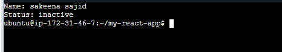

### Notes

Answer the following in your own words:
**1. What proves Nginx is listening on 0.0.0.0:80?

In the ss -tulpen output, there is a TCP line in the LISTEN state with the local address 0.0.0.0:80 and the process name nginx (users:((“nginx”,...))). The address 0.0.0.0 means Nginx accepts connections on every network interface of the server, so it is reachable from outside and not just from localhost.

**2. What proves SSH is active on port 22?

The same output shows a TCP LISTEN line on port 22 (0.0.0.0:22, and also [::]:22 for IPv6) owned by the sshd process. This proves the SSH service is running and ready to accept remote logins on the standard port.

**3. Did you find any unexpected open ports? Explain briefly.

No, I did not find any unexpected ports. Apart from ports 80 (Nginx) and 22 (SSH), the other entries are normal Ubuntu system services that only listen locally or on the private network: port 53 (systemd-resolved, local DNS), port 323 (chrony, time sync) and the DHCP client ports 68 and 546. Also, ufw is inactive, but access from the internet is controlled by the AWS security group, which only allows SSH, HTTP and HTTPS.

# Task 2 — Service Health & Systemd Validation (Nginx)

## Goal

Verify that Nginx is properly installed, running, enabled at boot, and safely configured.

### Evidence

#### Screenshot 1 — Output of `systemctl status nginx --no-pager`

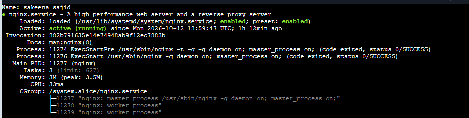

#### Screenshot 2 — Output of `sudo nginx -t`
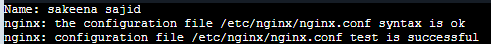

#### Screenshot 3 — Output of `sudo ss -lptn '( sport = :80 )'`

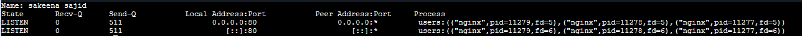

### Notes

Answer the following in your own words:

**1. What happens if Nginx fails to restart in production?**

If Nginx fails to restart, the website goes down because nothing is listening on port 80 any more, so users see connection errors or timeouts. The usual causes are a syntax error in the config file, a port conflict, or a permission problem. To avoid this, I should always run sudo nginx -t before restarting, and if a restart fails, check systemctl status nginx and journalctl -u nginx to find the exact error.

**2. What's your basic rollback plan?**
Before changing any config, I make a backup of the working file, for example sudo cp /etc/nginx/sites-available/default /etc/nginx/sites-available/default.bak. If something breaks, I copy the backup back over the config, run sudo nginx -t to confirm it is valid, and restart Nginx. Then I verify with systemctl status nginx and curl -I http://<public-ip> that the site returns 200 OK again.

# Task 3 — Logs & Request Trace

## Goal

Verify real traffic flow and analyze logs to understand system behavior and errors.

### Evidence

#### Screenshot 1 — Output of `sudo tail -n 30 /var/log/nginx/access.log`

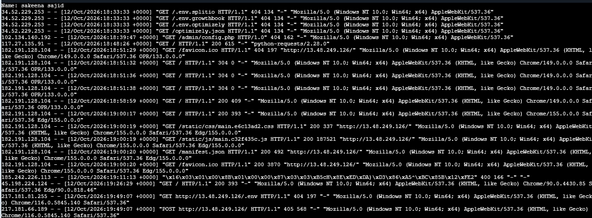

#### Screenshot 2 — Output of `sudo tail -n 30 /var/log/nginx/error.log`

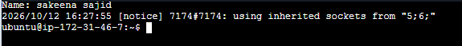

#### Screenshot 3 — Output of `sudo journalctl -u nginx --no-pager -n 50`

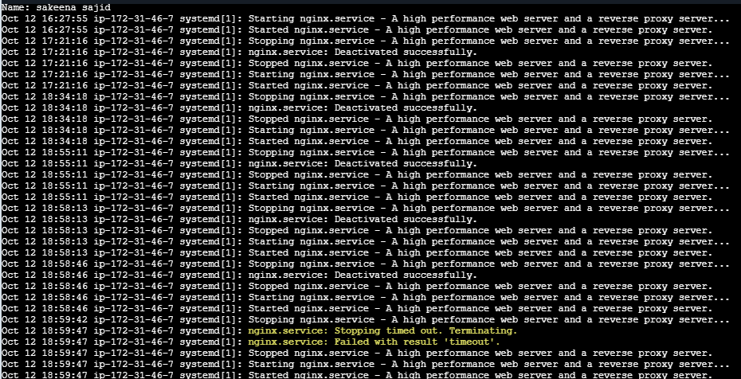

### Notes

Answer the following in your own words:

**1. Were there any errors in the logs?**

Yes. In the access log, I found requests like GET /.env... HTTP/1.1" 404. This means an external scanner or bot asked for a hidden configuration file that does not exist on my server, so Nginx replied with 404 Not Found. This is common on any public IP and does not mean my deployment is broken. In the journalctl output, I saw nginx.service: Stopping timed out. Terminating. and nginx.service: Failed with result 'timeout'. This means that during one restart, Nginx did not shut down in time, so systemd forced it to stop; after that, the service started again normally.

**2. If there were no errors, what does that indicate about the system?**

I did find a few minor errors, but none of them caused an outage. The 404 lines are harmless client-side errors from bots, and the one timeout happened during a restart and recovered right away, since the service is active and the app returns 200 OK. So the system is healthy overall. If the logs had been completely clean, it would have indicated that Nginx started correctly, the config is valid and all requested files exist.

**3. Based on the access logs, were your curl requests visible in the log entries? What does that prove about traffic flow?**

Yes, my curl requests appeared in access.log with a timestamp, the request (HEAD / or GET /), status 200 and the user agent curl/.... This proves the traffic reached Nginx on port 80, Nginx processed it, and returned the page successfully, so the full path from client to web server is working.

# Task 4 — System Resource Health Check (Capacity Red Flags)

## Goal

Assess server capacity and detect potential performance or failure risks.

### Evidence

#### Screenshot 1 — Output of `uptime`

#### Screenshot 2 — Output of `free -h`

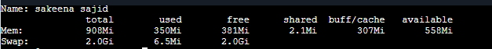

#### Screenshot 3 — Output of `df -h`

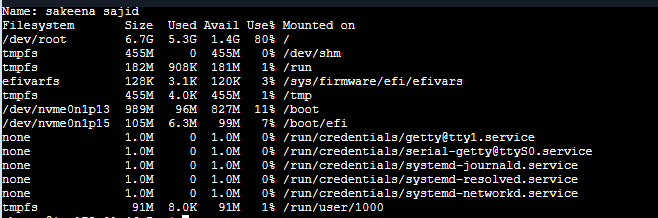

#### Screenshot 4 — Output of `sudo du -sh /var/* | sort -h`

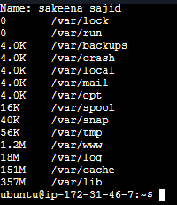

### Notes

Answer the following in your own words:

**1. Which resource looks most critical right now? (CPU/load, memory, or disk) Explain why.**

Write your answer here.

---

**2. What happens if disk becomes 100% full in a production server?**

Memory looks like the most critical resource right now. The server has only about 1 GB of RAM, and free -h shows [used] used out of [total], with [available] still available. Since this is a small instance, memory is the first resource that can run out, and when it does, processes can be killed by the OOM killer. CPU load is low ([load average]) and disk usage is only [Use%] on /, so they are not a concern.

# Task 5 — Configuration & Deployment Verification

## Goal

Ensure the correct React build is deployed and Nginx is serving it properly.

### Evidence

#### Screenshot 1 — Output of `ls -lah /var/www/html | head -n 20`

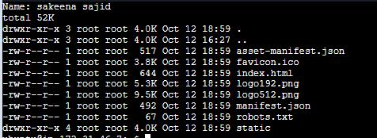

#### Screenshot 2 — Output of `grep -R "Deployed by" -n /var/www/html 2>/dev/null | head`

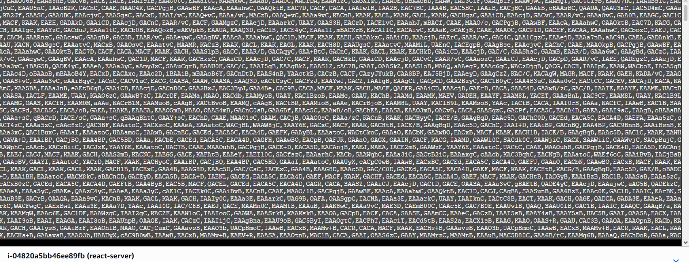

#### Screenshot 3 — Output of `grep -n "try_files" /etc/nginx/sites-available/default`

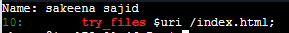

### Notes

Answer the following in your own words:

**1. How do you confirm that the correct version of the application is deployed?**

I confirm it in three steps. First, I run ls -lah /var/www/html to check that the build files (index.html and the static/ folder) are present and have recent timestamps, which shows the latest build was copied to the web root. Second, I run grep -R "Deployed by" -n /var/www/html, which finds my personalized text (my name) inside the deployed files, proving that Nginx is serving the new build and not an old one or only the source code. Third, I open http://<public-ip> in the browser and check that my name is visible on the page, and I verify with grep -n "try_files" that the Nginx config contains try_files $uri /index.html; so React routing works.

# Task 6 — Nginx Configuration Failure Simulation

## Goal

Simulate a real-world Nginx misconfiguration and recover the service safely.

### Evidence

#### Screenshot 1 — Output of `sudo nginx -t` showing the syntax error (broken config)

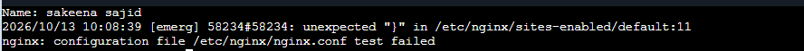

#### Screenshot 2 — Output of `sudo nginx -t` showing syntax ok (fixed config)

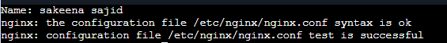

#### Screenshot 3 — Output of `curl -I http://<public-ip>` confirming recovery (200 OK)

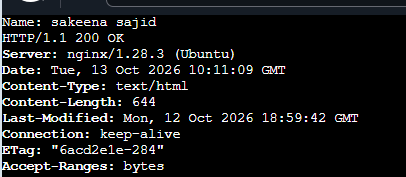

### Notes

Answer the following in your own words:

**1. What caused the configuration failure?**

I removed the semicolon at the end of the try_files $uri /index.html; line in the Nginx config. Every directive in Nginx must end with a semicolon, so Nginx could not parse the file and nginx -t reported a syntax error (unexpected "}") and failed the configuration test.

**2. How did you fix the issue?**

I restored the working configuration from the backup I made before the change (default.good), copying it back over /etc/nginx/sites-available/default. Then I ran sudo nginx -t to confirm the syntax was OK, reloaded Nginx with sudo systemctl reload nginx, and verified with curl -I http://<public-ip> that the site returned 200 OK.

**3. How can you avoid this kind of issue in real production systems?**

I should always back up the working config before editing, and run sudo nginx -t before every reload or restart so that a broken file is never applied. Using reload instead of restart avoids dropping connections, and keeping configs in version control (Git) makes review and rollback easy. In larger setups, changes should be tested in a staging environment and deployed through a CI/CD pipeline with automatic config validation.
# Task 7 — Web Application Failure Simulation

## Goal

Simulate missing deployment content and recover the application safely.

### Evidence

#### Screenshot 1 — Output of `curl -I http://<public-ip>` showing failure (non-200 response)

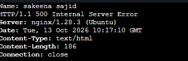

#### Screenshot 2 — Output of `curl -I http://<public-ip>` confirming recovery (200 OK)

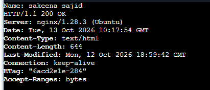

### Notes

Answer the following in your own words:

**1. What caused the application to break in this scenario?**

I moved index.html out of the web root /var/www/html, which simulates missing deployment content. Nginx was still running and the config was valid, but it had no page to serve, so requests failed with an error response (500/404) instead of 200 OK.

**2. How did you fix the issue and restore the application?**

I moved the backed-up index.html back into /var/www/html. No Nginx restart was needed because Nginx reads files from disk on every request. I then ran curl -I http://<public-ip> and got 200 OK, and confirmed the page in the browser.

**3. What steps would you take to prevent this kind of issue in real production systems?**

I would automate deployments with a CI/CD pipeline instead of copying files by hand, so a deployment never leaves the web root half-empty. I would keep versioned builds with a quick rollback option, make a backup before changing files, and add a health check or uptime monitor that alerts me when the site stops returning 200. A post-deploy smoke test (curl -I) should also verify each release.

# Task 8 — Security & Reliability Review

## Goal

Review and reflect on the security and reliability practices applied during this assignment.

### Security & Reliability Notes

Answer the following in your own words:
1. Why is SSH key-based authentication more secure than sharing passwords?

A key pair uses a private key that stays on my machine and a public key on the server, so no secret is sent over the network and there is nothing short to guess. Passwords can be weak, reused, guessed by brute force or leaked, while a long cryptographic key is practically impossible to guess. Keys can also be revoked per user without changing a shared password.

**2. Why should only required ports be open on a production server?**

Each open port is a possible entry point for attackers. Keeping only the ports that are needed (for example 22, 80 and 443) reduces the attack surface, limits what scanners and bots can find, and lowers the risk from vulnerable services I forgot were running.

**3. Why is it important for Nginx to be enabled on boot?**

If the server reboots (maintenance, a crash or an instance restart), a service that is not enabled will stay stopped and the website will be down until someone starts it manually. Enabling Nginx on boot makes it start automatically so the site recovers by itself and downtime is shorter.

**4. What are the risks of sharing secrets, keys, or credentials publicly?**

Anyone can use leaked keys to access or control my server and cloud account. This can lead to data theft, deleted resources, malware or crypto-mining on my account, and large unexpected bills. Bots scan public repositories for leaked keys within minutes, so exposed credentials must be rotated immediately.

**5. Why should cloud resources be stopped or terminated when they are no longer needed?**

Cloud resources are billed while they run, so unused instances waste money or free credits. Idle servers can also stay unpatched and become security risks. Stopping or terminating them keeps costs under control and the environment clean.

# LinkedIn Post (Required)

## Evidence

#### LinkedIn Post URL

Paste your LinkedIn post URL here:

https://lnkd.in/p/d7HaeVbB

#### Screenshot — Published LinkedIn post
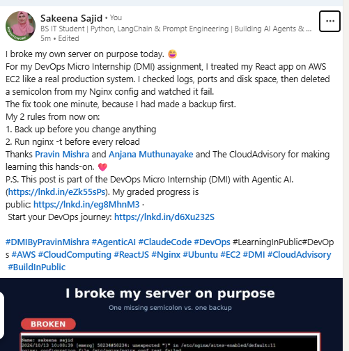

# Submission Instructions

- Add all required screenshots in your submission
- Full name must be visible in required screenshots
- Do not expose sensitive information (keys, passwords, account IDs)

---

# Completion Checklist

- [ ] Task 1: Screenshots (browser, ip a, ss -tulpen, ufw status) + Notes answered
- [ ] Task 2: Screenshots (nginx status, nginx -t, ss port 80) + Notes answered
- [ ] Task 3: Screenshots (access log, error log, journalctl) + Notes answered
- [ ] Task 4: Screenshots (uptime, free -h, df -h, du -sh) + Notes answered
- [ ] Task 5: Screenshots (ls html, grep deployed by, grep try_files) + Notes answered
- [ ] Task 6: Screenshots (nginx -t fail, nginx -t pass, curl recovery) + Notes answered
- [ ] Task 7: Screenshots (curl failure, curl recovery) + Notes answered
- [ ] Task 8: Security & Reliability Notes answered
- [ ] LinkedIn post published and URL submitted
- [ ] Full Name visible in all required screenshots
- [ ] No sensitive data exposed

---

## 📌 About DMI & CloudAdvisory

DevOps Micro Internship (DMI) is a project-based DevOps program run by Pravin Mishra (The CloudAdvisory) focused on real-world execution, systems thinking, and career readiness.

It helps learners build strong DevOps foundations with hands-on experience.

---

## 📌 Resources

- 🌐 DMI Official Website: https://dmi.pravinmishra.com?utm_source=github&utm_medium=readme  
- 🎓 University: https://university.pravinmishra.com?utm_source=github&utm_medium=readme  
- 💬 Discord Community: https://discord.pravinmishra.com?utm_source=github&utm_medium=readme  
- 📝 Blog: https://dmi.pravinmishra.com/blog?utm_source=github&utm_medium=readme  
- ▶️ YouTube Playlist: https://www.youtube.com/playlist?list=PLFeSNDtI4Cho  
- 🔗 Pravin Mishra (LinkedIn): https://www.linkedin.com/in/pravin-mishra-aws-trainer/  
- 🏢 CloudAdvisory (LinkedIn): https://www.linkedin.com/company/thecloudadvisory/

---

*This submission is part of DevOps Micro Internship (DMI) Cohort 3 — Agentic AI Track.*
