# Assignment 5 — Bash Script Automation Drill (OPS Checklist)

Part of the DevOps Micro Internship (DMI) Cohort 3 with Agentic AI

---

## Purpose

In this assignment, you will practice Bash scripting by building a series of small automation scripts covering environment setup, variables, arrays, loops, file conditionals, if-else logic, and functions. These scripts form the foundation of real-world Linux automation used in DevOps, cloud, and production support environments.

---

# Task 1 — Bash Environment & Workspace Setup

## Goal

Verify that Bash is available on your system and create a clean workspace for this assignment.

### Evidence

#### Screenshot 1 — Output of `echo $SHELL` and `bash --version`

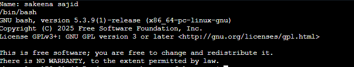

#### Screenshot 2 — Output of `pwd` and `ls -lah` showing the scripts directory

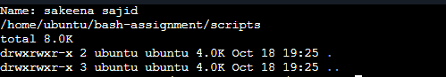

### Notes

Answer the following in your own words:

**1. What is Bash?**
Bash (Bourne Again Shell) is a command-line interpreter and scripting language for Linux. It lets me run commands and also write scripts that automate repetitive tasks.

**2. What is the difference between shell and Bash?**
A shell is the general name for any program that takes commands from the user and passes them to the operating system, such as sh, zsh or ksh. Bash is one specific shell, and it is the default on most Linux systems.

**3. Why is it important to confirm the Bash version before writing scripts?**
Different Bash versions support different features. For example, associative arrays need Bash 4 or newer. Checking the version makes sure my script will run correctly and does not break on another server.

# Task 2 — Your First Bash Script

## Goal

Create your first Bash script, make it executable, and run it from the terminal.

### Evidence

#### Screenshot 1 — Content of `first-script.sh`

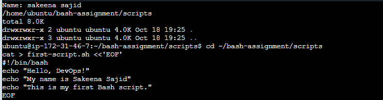

#### Screenshot 2 — Output of `./first-script.sh`

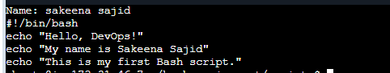

#### Screenshot 3 — Output of `ls -l first-script.sh` showing executable permission
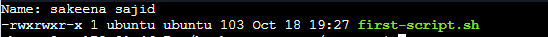

### Notes

Answer the following in your own words:

**1. What is the purpose of #!/bin/bash?**
It is called the shebang. It tells the system which interpreter should run the script, here /bin/bash, so the script behaves the same no matter which shell I am using.

**2. Why do we use chmod +x before running a script?**
A new file does not have execute permission by default. chmod +x adds it, and without it running ./script.sh gives a “Permission denied” error.

**3. What is the difference between running a script using ./script.sh and bash script.sh?**
./script.sh needs execute permission and uses the interpreter from the shebang line. bash script.sh starts Bash directly and gives it the file to read, so it works even without execute permission.

# Task 3 — Variables: User Information Script

## Goal

Use variables to store and display user-related information.

### Evidence

#### Screenshot 1 — Content of `user-info.sh`

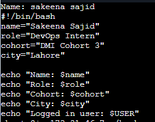

#### Screenshot 2 — Output of `./user-info.sh`

### Notes

Answer the following in your own words:

**1. What is a variable in Bash?**
A variable is a named place that stores a value, such as text or a number, so I can reuse it later in the script.

**2. Why should we avoid spaces around the = sign when creating variables?**
Bash treats a space as a separator between a command and its arguments. With name = "value" it would try to run a command called name, which gives a “command not found” error. The correct form is name="value".

**3. How do you access the value stored inside a Bash variable?**
By putting a dollar sign before the variable name, for example $name or ${name}.

# Task 4 — Arrays & Loops: Tools Checklist Script

## Goal

Use arrays and loops to print a checklist of tools used in Bash scripting.

### Evidence

#### Screenshot 1 — Content of `tools-checklist.sh`

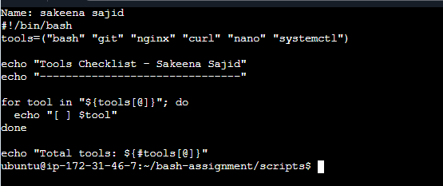

#### Screenshot 2 — Output of `./tools-checklist.sh`

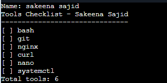

### Notes

Answer the following in your own words:

**1. What is an array in Bash?**

An array is a variable that holds a list of values under one name, for example `tools=("bash" "git" "nginx")`. Each value has a position (index) starting from 0.

**2. Why are arrays useful in scripts?**

They let me keep related items together and process them in one go, instead of creating many separate variables. Adding or removing an item only needs a change in one place.

**3. What does `"${tools[@]}"` mean?**

It expands to all the elements of the `tools` array, with each element kept as a separate word. The quotes make sure items that contain spaces are not split apart.

**4. What is the purpose of the `for` loop in this script?**

The `for` loop goes through the array one element at a time and runs the same `echo` command for each tool, so the whole checklist is printed without repeating the code.

# Task 5 — Loops: Number Counter Script

## Goal

Use loops to repeat a task multiple times.

### Evidence

#### Screenshot 1 — Content of `counter.sh`

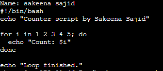

#### Screenshot 2 — Output of `./counter.sh`

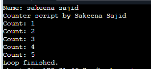

### Notes

Answer the following in your own words:
**1. What is a loop?**

A loop is a control structure that repeats a block of commands several times, either for a fixed list of values or until a condition changes.

**2. Why do we use loops in Bash scripting?**

Loops save me from writing the same command again and again. They make scripts shorter, easier to change, and useful for tasks like processing many files or servers.

**3. How many times did the loop run in your script?**

The loop ran 5 times, once for each value from 1 to 5.

**4. What would you change if you wanted the loop to run 10 times?**

I would change the list of values to run up to 10, for example `for i in {1..10}; do`, so the loop goes from 1 to 10.

# Task 6 — Files & Conditionals: File Validation Script

## Goal

Use file checks and conditionals to verify whether files and directories exist.

### Evidence

#### Screenshot 1 — Output of `ls -lah ../test-folder`

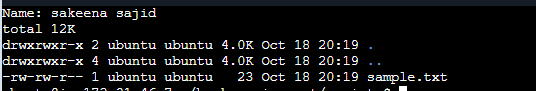

#### Screenshot 2 — Content of `file-check.sh`

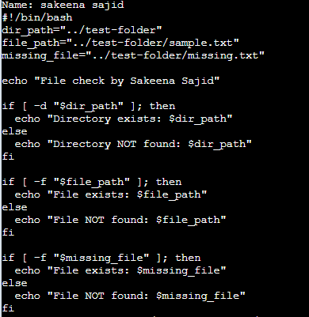

#### Screenshot 3 — Output of `./file-check.sh`

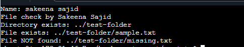

### Notes

Answer the following in your own words:

**1. What does `-d` check in Bash?**

`-d` checks whether the given path exists and is a directory.

---

**2. What does `-f` check in Bash?**

`-f` checks whether the given path exists and is a regular file.

---

**3. Why should file and directory paths be stored in variables?**

Storing paths in variables means I write each path only once. If the path changes later, I update one line instead of searching the whole script, and it also makes the script easier to read and less error-prone.

---

**4. What happens if the file does not exist?**

The `-f` test returns false, so the `else` branch runs and the script prints a message such as "File NOT found". The script keeps running and does not crash.

---

# Task 7 — Conditionals: Pass or Retry Script

## Goal

Use if-else conditionals to make decisions based on a variable value.

### Evidence

#### Screenshot 1 — Content of `score-check.sh` with `score=85`

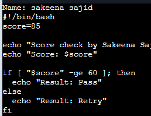

#### Screenshot 2 — Output showing `Result: Pass`

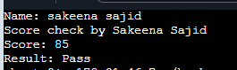

#### Screenshot 3 — Content of `score-check.sh` with `score=55`
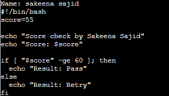

#### Screenshot 4 — Output showing `Result: Retry`

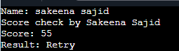

### Notes

Answer the following in your own words:

**1. What is the purpose of if-else in Bash?**

It lets a script make decisions. If a condition is true, one block of commands runs, otherwise another block runs.

---

**2. What does `-ge` mean?**

`-ge` means "greater than or equal to". In `[ "$score" -ge 60 ]` the test is true when the score is 60 or more.

---

**3. Why should conditions be tested with different values?**

Testing with different values (85 and 55) proves that both branches work, so I know the script does not only pass or only fail by accident.

---

**4. How can conditionals help in automation scripts?**

They let a script react to what it finds, for example stopping if a file is missing, restarting a service only when it is down, or sending an alert when disk usage is too high.

---

# Task 8 — Functions: Final Bash Automation Script

## Goal

Create a final Bash script using functions to organize reusable code.

### Evidence

#### Screenshot 1 — Content of `final-automation.sh`

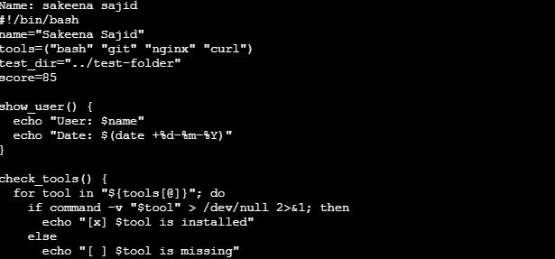

#### Screenshot 2 — Output of `./final-automation.sh`

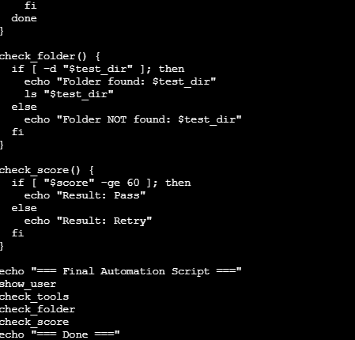

#### Screenshot 3 — Output of `ls -lah` showing all created scripts

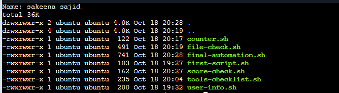

### Notes

Answer the following in your own words:

**1. What is a function in Bash?**

A function is a named block of commands that I define once and can call whenever I need it.

---

**2. Why are functions useful in scripts?**

They remove repeated code, make a script easier to read and test, and let me change one part without touching the rest.

---

**3. Which functions did you create in this script?**

I created four functions: `show_user`, `check_tools`, `check_folder` and `check_score`.

---

**4. How does this final script combine variables, arrays, loops, conditionals, files, and functions?**

Variables store the name, folder path and score. An array holds the list of tools, and a `for` loop goes through it. Conditionals (`if`) check whether each tool is installed, whether the folder exists (`-d`) and whether the score passes. Each of these steps is wrapped in its own function, and the main part of the script simply calls the functions one by one.

---

# LinkedIn Post (Required)

## Evidence

#### LinkedIn Post URL

Paste your LinkedIn post URL here:

`Add your URL here`

---

#### Screenshot — Published LinkedIn post

Add your screenshot here.

---

# Submission Instructions

- Add all required screenshots in your submission
- Full name must be visible in required screenshots
- All script files must be created and run successfully
- Required notes must be answered clearly for every task
- Do not expose sensitive information (keys, passwords, credentials)

---

# Completion Checklist

 [✅ ] Task 1: Environment setup verified, workspace created (Screenshots 1–2, Notes answered)
 [✅] ] Task 2: First script created, executed, permissions verified (Screenshots 1–3, Notes answered)
 [✅ ] Task 3: Variables script created and run (Screenshots 1–2, Notes answered)
 [ ✅] Task 4: Arrays and loops script created and run (Screenshots 1–2, Notes answered)
 [✅ ] Task 5: Counter loop script created and run (Screenshots 1–2, Notes answered)
 [✅ ] Task 6: File validation script created and run (Screenshots 1–3, Notes answered)
 [ ✅] Task 7: Pass/Retry conditional script tested with both values (Screenshots 1–4, Notes answered)
 [✅ ] Task 8: Final automation script created and run (Screenshots 1–3, Notes answered)
 [✅ ] All scripts run without errors
 [✅ ] Full Name visible in all required screenshots
 [✅ ] LinkedIn post published and URL submitted
[✅ ] No sensitive data exposed

---

## 📌 About DMI & CloudAdvisory

DevOps Micro Internship (DMI) is a project-based DevOps program run by Pravin Mishra (The CloudAdvisory) focused on real-world execution, systems thinking, and career readiness.

It helps learners build strong DevOps foundations with hands-on experience.

---

## 📌 Resources

- 🌐 DMI Official Website: https://dmi.pravinmishra.com?utm_source=github&utm_medium=readme  
- 🎓 University: https://university.pravinmishra.com?utm_source=github&utm_medium=readme  
- 💬 Discord Community: https://discord.pravinmishra.com?utm_source=github&utm_medium=readme  
- 📝 Blog: https://dmi.pravinmishra.com/blog?utm_source=github&utm_medium=readme  
- ▶️ YouTube Playlist: https://www.youtube.com/playlist?list=PLFeSNDtI4Cho  
- 🔗 Pravin Mishra (LinkedIn): https://www.linkedin.com/in/pravin-mishra-aws-trainer/  
- 🏢 CloudAdvisory (LinkedIn): https://www.linkedin.com/company/thecloudadvisory/

---

*This submission is part of DevOps Micro Internship (DMI) Cohort 3 — Agentic AI Track.*
